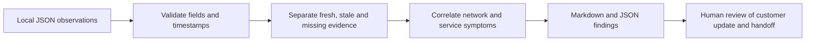

# Network support triage

An offline Python tool for reviewing an edge-device support bundle and drafting a useful escalation. It separates observed failures from missing evidence instead of treating every offline device as a network outage.

**Start with [the example report](example-report.md)**, then run the same case locally. Python 3.10+ is the only dependency; no API keys, packages, or hardware are needed.

## Why I built this

My background is in enterprise network support, remote sites, and broadcast operations. The habits carry over to product support: establish impact, compare working and failing paths, preserve timestamps, and give the next team enough evidence to act. These are new portfolio demonstrations using fictional devices and observations, not former-employer code or tickets. The Linux/service examples are learning demonstrations, not claims of prior product or IoT administration.

## Run it

Download this repository and open a terminal in its folder. On Windows, use `py` if `python` is not available.

```sh
python triage.py network-path-failure.json
python triage.py service-storage-issue.json --output reports/storage
python triage.py incomplete-evidence.json
python -m unittest discover -v
```

An output directory must be new, to avoid overwriting earlier evidence. Exit code `0` means analysis completed, **not that the device is healthy**. Exit code `2` means invalid input or an output error.

## How it works



| Scenario | What to look for |
| --- | --- |
| [Network path](network-path-failure.json) | DNS resolves but the TCP test fails; the tool does not blame the firewall or ISP without evidence |
| [Service and storage](service-storage-issue.json) | A failed service, high disk use, and a recent write error support a hypothesis, not a confirmed root cause |
| [Incomplete evidence](incomplete-evidence.json) | Missing checks and an old service observation remain unknown |

## Input contract

Use one of the three JSON files as a starting point. `schema_version` is integer `1`; `incident_id`, `device`, `reported_impact`, and timezone-aware `captured_at` are required. Checks are `dns`, `gateway`, `tcp`, `service`, `disk`, and `logs`. Uncollected checks may be omitted. Observed checks require `observed_at` no later than the bundle timestamp.

- DNS/gateway/TCP: `pass`, `fail`, `unknown`, or `not_collected`.
- Service: `running`, `stopped`, `failed`, `unknown`, or `not_collected`.
- Disk/logs: `collected`, `unknown`, or `not_collected`.
- DNS answers and TCP/gateway targets are IP addresses. A TCP check includes an integer port. Disk includes a mount and numeric percentage. Logs use explicit signals (`none`, `connect_timeout`, `no_space`, `service_exit`); there is no automatic log parser or AI diagnosis.
- Unknown checks contain only their status and optional detail. Duplicate JSON keys, nonfinite numbers, invalid states, and bundles over 1 MiB are rejected.

The 30-minute freshness window and 90%/95% disk thresholds are demonstration policies. They are not vendor limits or customer SLAs. An old bundle is evaluated relative to its own timestamp; this is historical review, not live monitoring.

## Runbooks and examples

- [Branch firewall outage](branch-firewall-outage.md) and [fictional Branch 07 incident](branch-07-recurring-outage.md)
- [Wireless client connectivity: EX4300 and Mist AP43](wireless-client-connectivity.md)
- [IPsec and Azure reachability](ipsec-azure-reachability.md)
- [Incident handoff template](incident-handoff.md)
- [Read-only Linux evidence collection](linux-evidence.md)
- [Hardware experience](hardware-experience.md)

## Limits

This tool does not connect to devices, execute commands, reproduce bugs, inspect video, or change configurations. It cannot prove application health or a root cause. Review the generated customer wording before using it. Keep actual customer logs, credentials, addresses, and device identifiers out of public repositories.

## Author

[Mohammed Alislam](https://github.com/malislam) · CCNP Enterprise · [LinkedIn](https://linkedin.com/in/malislam/)
