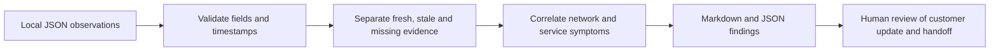
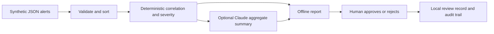

# Network support triage

Python tools for evidence-led network support: the original offline support-bundle analyzer and a synthetic incident-alert add-on with optional Claude summaries. Both separate observations from unconfirmed root causes.

**Start with [the example report](example-report.md)**, then run the same case locally. Python 3.10+ is the only dependency; no API keys, packages, or hardware are needed.

## Why I built this

My background is in enterprise network support, remote sites, and broadcast operations. The habits carry over to product support: establish impact, compare working and failing paths, preserve timestamps, and give the next team enough evidence to act. These are new portfolio demonstrations using fictional devices and observations, not former-employer code or tickets. The Linux/service examples are learning demonstrations, not claims of prior product or IoT administration.

## Run it

Download this repository and open a terminal in its folder. On Windows, use `py` if `python` is not available.

```sh
python triage.py network-path-failure.json
python triage.py service-storage-issue.json --output reports/storage
python triage.py incomplete-evidence.json
python -m unittest discover -v
```

An output directory must be new, to avoid overwriting earlier evidence. Exit code `0` means analysis completed, **not that the device is healthy**. Exit code `2` means invalid input or an output error.

## How it works



| Scenario | What to look for |
| --- | --- |
| [Network path](network-path-failure.json) | DNS resolves but the TCP test fails; the tool does not blame the firewall or ISP without evidence |
| [Service and storage](service-storage-issue.json) | A failed service, high disk use, and a recent write error support a hypothesis, not a confirmed root cause |
| [Incomplete evidence](incomplete-evidence.json) | Missing checks and an old service observation remain unknown |

## AI-assisted incident triage add-on

This separate command correlates **synthetic alerts only**. It does not ingest TAC
files, production logs or the original support bundles. No extra packages are required.
Start with the [sample incident report](examples/incident-report.md).
Compare it with the [live Claude draft and editorial review](examples/incident-report-claude.md)
and its [unaltered report JSON](examples/incident-report-claude.json). This example
is pending human approval: the review identifies unsupported timing mechanisms
and historical-check wording rather than treating a successful API call as validation.

```sh
python incident_triage.py run examples/alerts/routing-failure.json --output reports/routing-demo
python incident_triage.py review reports/routing-demo --decision approve --reviewer "Demo reviewer" --reason "Reviewed evidence; approve the proposed investigation"
python -m unittest discover -v
```

Read `report.md` and `report.json` before reviewing. Use `--decision reject` to record
a rejection. Approval records a human decision about the draft investigation; it
does not execute, schedule or authorize device changes. There is no command runner,
device connection, ticket creation or automatic remediation in this project.



### Synthetic scenarios and policy

| Fixture under `examples/alerts/` | Evidence | Expected severity |
| --- | --- | --- |
| `routing-failure.json` | Route change and TCP failure | SEV1 |
| `wan-congestion.json` | High utilization, loss and latency | SEV2 |
| `ha-failover.json` | HA event and application errors | SEV2 |
| `recurring-hardware.json` | Three power-supply alarms | SEV2 |

The strict JSON contract is `schema_version: 1`, `synthetic: true`, and 1–500
`alerts`. Each alert has only `id`, `site`, `device`, `observed_at`, `signal`, and
`impact`. IDs/site/device must match `demo-[a-z0-9-]+` (maximum 60 characters),
IDs must be unique, and timestamps must include a timezone. Signals are the eight
explicit values in `SIGNALS` in [incident_triage.py](incident_triage.py); impact is
`none`, `degraded`, or `outage`. Extra fields, duplicate keys, nonfinite numbers
and inputs over 1 MiB are rejected. Fictional labeling is an input contract, not
a detector that can prove data provenance; never relabel real data as synthetic.

Correlation uses site + signal family + fixed five-minute UTC bucket. Different
devices at the same site can correlate; adjacent buckets remain separate even
when alerts are seconds apart. Input order does not affect the result. Families
are routing, capacity, availability and hardware. Grouping is a heuristic for
investigation, not proof of a shared cause. Severity uses the highest reported
impact: outage → SEV1, degraded → SEV2, none → SEV3. Three or more hardware
alarms in a bucket raise SEV3 to SEV2 for problem review. These are demonstration
rules, not a production SLA. The model cannot set severity, correlation,
escalation, approval state or the deterministic suggested runbook.

### Optional Claude summary

Set `ANTHROPIC_API_KEY` in your local environment and select a model ID available
to your account. Never put the key in a command argument, fixture or committed file.
Then opt in explicitly:

```sh
python incident_triage.py run examples/alerts/wan-congestion.json --output reports/claude-demo --claude --model YOUR_MODEL_ID
```

This makes one potentially billable request to the
[Claude Messages API](https://platform.claude.com/docs/en/api/messages/create).
The provider receives only an allowlisted, de-identified projection: numbered
incident, family, severity, alert and device counts, the deterministic runbook step,
and the ordered event sequence as seconds since the incident's first alert, a
per-incident device ordinal (`device-1`, `device-2`), signal and impact.
Site/device/alert identifiers, real timestamps and raw input are omitted. Free-text
logs are not accepted at all. This data minimization avoids relying on regex
redaction of arbitrary logs. The prompt asks for four sections per incident
(what the evidence shows, ranked unconfirmed hypotheses, read-only checks, and
post-mortem notes) and forbids changing severity or claiming resolution.
There are no model tools. Responses are bounded, displayed in a plain-text code block and labeled
as an untrusted draft; humans must check them for unsupported claims.

Without `--claude`, no API call occurs even if a key is set. Missing configuration,
timeouts, API errors, invalid responses or truncated output retain the offline
report and record a sanitized failure in the report/audit. This fallback exits
successfully because deterministic analysis completed; check `summary.provider`
and `summary.failure` to see whether AI contributed. The request timeout is 30
seconds, output is capped at 1,500 tokens, and there are no automatic retries.
Tests mock the API; they do not demonstrate a successful live provider call.
The checked-in Claude example was separately generated through a live API call
using `claude-haiku-4-5-20251001`; its raw output is preserved with review notes.

### Review and audit files

Every run requires a new output directory and writes `report.json`, `report.md`,
and `audit.jsonl`. The creation event records UTC time, SHA-256 digests of canonical
input/report JSON, provider, model and any sanitized provider failure. Review
verifies the report digest and writes an exclusive `review.json` plus an audit
event with reviewer, reason and decision. A second review or changed report is
rejected; run a new report for revisions. The report remains the original pending
snapshot, while `review.json` holds the final decision. Review the JSON as the
authoritative evidence if the Markdown file has been edited.

Audit files are local demo records, not authenticated identities or tamper-proof
storage. Someone who can rewrite both report and audit can replace the digests.
Writes are not a multi-file database transaction: a disk failure can leave an
incomplete output directory. Preserve it for inspection and run again into a new
directory; do not use partial artifacts as an approval. Keep generated reports
and local credentials out of version control (`reports/` and `.env` are ignored).

## Original support-bundle input contract

Use one of the three JSON files as a starting point. `schema_version` is integer `1`; `incident_id`, `device`, `reported_impact`, and timezone-aware `captured_at` are required. Checks are `dns`, `gateway`, `tcp`, `service`, `disk`, and `logs`. Uncollected checks may be omitted. Observed checks require `observed_at` no later than the bundle timestamp.

- DNS/gateway/TCP: `pass`, `fail`, `unknown`, or `not_collected`.
- Service: `running`, `stopped`, `failed`, `unknown`, or `not_collected`.
- Disk/logs: `collected`, `unknown`, or `not_collected`.
- DNS answers and TCP/gateway targets are IP addresses. A TCP check includes an integer port. Disk includes a mount and numeric percentage. Logs use explicit signals (`none`, `connect_timeout`, `no_space`, `service_exit`); there is no automatic log parser or AI diagnosis.
- Unknown checks contain only their status and optional detail. Duplicate JSON keys, nonfinite numbers, invalid states, and bundles over 1 MiB are rejected.

The 30-minute freshness window and 90%/95% disk thresholds are demonstration policies. They are not vendor limits or customer SLAs. An old bundle is evaluated relative to its own timestamp; this is historical review, not live monitoring.

## Runbooks and examples

- [Branch firewall outage](branch-firewall-outage.md) and [fictional Branch 07 incident](branch-07-recurring-outage.md)
- [Wireless client connectivity: EX4300 and Mist AP43](wireless-client-connectivity.md)
- [IPsec and Azure reachability](ipsec-azure-reachability.md)
- [Incident handoff template](incident-handoff.md)
- [Read-only Linux evidence collection](linux-evidence.md)
- [Hardware experience](hardware-experience.md)

## Limits

This tool does not connect to devices, execute commands, reproduce bugs, inspect video, or change configurations. It cannot prove application health or a root cause. Review the generated customer wording before using it. Keep actual customer logs, credentials, addresses, and device identifiers out of public repositories.

## Author

[Mohammed Alislam](https://github.com/malislam) · CCNP Enterprise · [LinkedIn](https://linkedin.com/in/malislam/)
